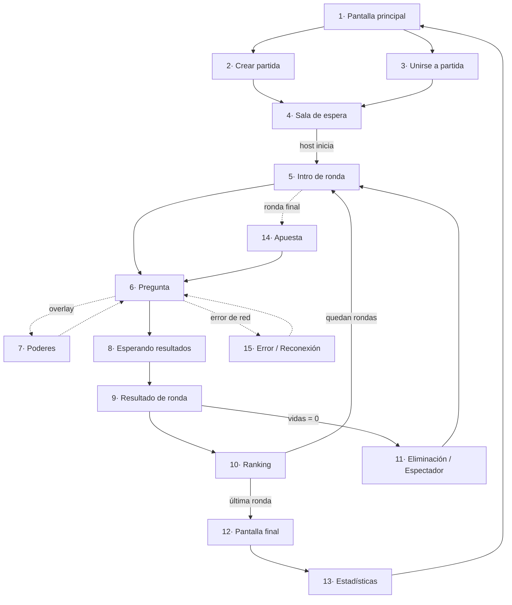

> **Documento histórico de la etapa 2.** El contrato (`docs/contrato/`) manda. Este archivo puede mencionar rondas FAST/BOMB, 5 poderes o estados ALIVE/ELIMINATED que NO existen en el contrato. Nombre del juego: Trivia Chaos.

# Trivia Chaos — Pantallas del juego y su relación con la API

**Versión del documento:** 1.0
**Etapa:** Segunda entrega
**Documento complementario:** `trivia-chaos-documentacion-api.md`

---

## 1. Mapa de navegación



**Pantallas añadidas respecto a la lista original y por qué:**

- **5 · Intro de ronda** — sin ella no hay forma de anunciar que viene una ronda especial.
  Sin ese aviso, el sistema de rondas es invisible para el jugador.
- **8 · Esperando resultados** — entre responder y ver el resultado pasan varios segundos.
  Sin pantalla propia, la interfaz parece congelada.
- **14 · Apuesta** — la ronda final con apuestas necesita una fase de entrada previa.
- **15 · Error / Reconexión** — el polling falla tarde o temprano. Hay que diseñarlo.

**Pantallas fusionadas:** *Selección de respuesta* y *Uso de poderes* no son pantallas
independientes. La primera es una interacción dentro de la pantalla de pregunta; la segunda
es un panel superpuesto. Tratarlas como pantallas separadas rompería el temporizador.

---

## 2. Fichas de pantalla

### Pantalla 1 · Pantalla principal

| | |
|---|---|
| **Objetivo** | Punto de entrada. Elegir entre crear una partida o unirse a una existente. |
| **Estado previo** | Ninguno |

**Elementos visuales:** logotipo animado de Trivia Chaos, fondo con partículas, campo de
nickname, selector de avatar (carrusel de 8 opciones), versión del juego en el pie.

**Botones:** `CREAR PARTIDA` (primario), `UNIRSE` (secundario), `Cómo se juega` (terciario).

**Información mostrada:** nombre del juego, nickname escrito, avatar seleccionado.

**Interacción:** el jugador escribe su nickname (3–16 caracteres) y elige avatar. Ambos
botones permanecen deshabilitados hasta que el nickname sea válido.

**Endpoints:** `POST /api/v1/players` al pulsar cualquiera de los dos botones. El `token`
devuelto se guarda en memoria de la aplicación.

**Después de la acción:** `CREAR PARTIDA` → pantalla 2. `UNIRSE` → pantalla 3.
Error `422 NICKNAME_INVALID` → mensaje bajo el campo, sin cambiar de pantalla.

---

### Pantalla 2 · Crear partida (configuración)

| | |
|---|---|
| **Objetivo** | Que el host defina las reglas antes de abrir la sala. |
| **Estado previo** | Sesión creada |

**Elementos visuales:** panel de configuración en tarjetas; vista previa del código como
placeholder.

**Controles:**

| Control | Tipo | Rango |
|---|---|---|
| Número de rondas | Slider | 5 – 20 (def. 10) |
| Vidas iniciales | Selector | 1 – 5 (def. 3) |
| Máximo de jugadores | Selector | 2 – 12 (def. 8) |
| Categorías | Multiselección de chips | Las 10 categorías |
| Dificultad | Multiselección | Fácil / Medio / Difícil |
| Poderes | Interruptor | Activado |
| Rondas especiales | Interruptor | Activado |
| Al quedarse sin vidas | Radio | Espectador / Eliminado |

**Botones:** `ABRIR SALA` (primario), `Volver`.

**Endpoints:** `POST /api/v1/rooms` con el objeto `settings`.

**Después de la acción:** respuesta `201` → pantalla 4 con el `code` recibido.

---

### Pantalla 3 · Unirse a partida

| | |
|---|---|
| **Objetivo** | Validar el código e incorporar al jugador a la sala. |
| **Estado previo** | Sesión creada |

**Elementos visuales:** campo de código de 6 casillas grandes (mayúsculas automáticas,
avance de foco al escribir), vista previa de la sala una vez validado el código.

**Vista previa (tras validar):** nombre del host, jugadores conectados (`4/8`), número de
rondas, si los poderes están activos.

**Botones:** `ENTRAR` (habilitado con 6 caracteres), `Volver`.

**Interacción:** al completarse el sexto carácter se llama automáticamente a `GET` para
validar; la vista previa aparece o se muestra el error. El botón `ENTRAR` confirma.

**Endpoints:**
1. `GET /api/v1/rooms/{code}` — validación en vivo, sin unirse.
2. `POST /api/v1/rooms/{code}/players` — al pulsar `ENTRAR`.

**Después de la acción:** `201` → pantalla 4.

**Manejo de errores en pantalla:**

| Respuesta | Mensaje al jugador |
|---|---|
| `404 ROOM_NOT_FOUND` | «No existe una sala con ese código» + agitar el campo |
| `409 ROOM_FULL` | «Esta sala ya está llena» |
| `409 GAME_ALREADY_STARTED` | «La partida ya comenzó» |
| `422 NICKNAME_TAKEN` | «Ese nombre ya está en uso en esta sala» + campo para cambiarlo |

---

### Pantalla 4 · Sala de espera

| | |
|---|---|
| **Objetivo** | Reunir jugadores y permitir al host ajustar e iniciar. |
| **Estado previo** | Participante creado en la sala |

**Elementos visuales:** el **código en tamaño grande** con botón de copiar, cuadrícula de
tarjetas de jugador (avatar + nickname + corona en el host), contador `4/8`, resumen de la
configuración, animación de entrada al conectarse alguien.

**Botones:**
- Host: `INICIAR PARTIDA` (deshabilitado con <2 jugadores), `Editar configuración`, `Expulsar` en cada tarjeta, `Cerrar sala`.
- Jugador: `Salir de la sala`.

**Interacción:** polling cada 2 s para refrescar la lista de participantes. El host inicia
cuando quiere.

**Endpoints:**
- `GET /api/v1/rooms/{code}` — polling
- `PATCH /api/v1/rooms/{code}` — editar configuración (host)
- `DELETE /api/v1/rooms/{code}/players/{id}` — salir o expulsar
- `POST /api/v1/rooms/{code}/games` — iniciar (host)

**Después de la acción:** todos los clientes detectan `status: IN_GAME` en el siguiente
polling y pasan a la pantalla 5. **A partir de aquí, el cliente cambia su polling a
`GET /games/{id}/state`, que es la única fuente de verdad durante la partida.**

---

### Pantalla 5 · Intro de ronda

| | |
|---|---|
| **Objetivo** | Anunciar el número y el tipo de ronda, y dar un respiro entre preguntas. |
| **Duración** | 3 s, controlada por el servidor |

**Elementos visuales:** «RONDA 3 DE 10» en grande, distintivo del tipo de ronda con color e
icono propios, categoría de la pregunta, cuenta regresiva 3-2-1.

| Tipo | Color | Anuncio |
|---|---|---|
| `NORMAL` | Azul | Ronda normal |
| `FAST` | Amarillo | ⚡ Ronda rápida — ¡solo 10 segundos! |
| `DOUBLE` | Morado | ×2 Ronda doble — puntos duplicados |
| `BOMB` | Rojo | 💣 Ronda bomba — el último en acertar pierde una vida |
| `FINAL_BET` | Dorado | 🏆 Ronda final — apuesta tus puntos |

**Botones:** ninguno. Pantalla pasiva.

**Endpoints:** `GET /api/v1/games/{id}/state` (fase `ROUND_INTRO`).

**Después:** automático a pantalla 6 cuando la fase cambie a `QUESTION`.

---

### Pantalla 6 · Pregunta

| | |
|---|---|
| **Objetivo** | Presentar la pregunta y capturar la respuesta antes del deadline. |
| **Es la pantalla principal del juego.** | |

**Elementos visuales:**
- **Barra de tiempo** superior, que se vacía y cambia de color (verde → amarillo → rojo).
  Se calcula con `endsAt − serverTime`, no con un contador local.
- Texto de la pregunta, centrado.
- Etiquetas de categoría y dificultad.
- **4 botones de respuesta** en cuadrícula 2×2, cada uno con color y forma distintos
  (accesibilidad: nunca solo color).
- Barra lateral con mis vidas (❤️❤️🖤), mi puntaje y mi posición.
- Indicador «3 de 5 ya respondieron» (usa `players[].hasAnswered`, nunca revela qué eligieron).
- Barra de poderes en la parte inferior.

**Interacción:** un toque en una opción la envía. Los cuatro botones se bloquean al instante
y la pantalla pasa a estado «respondido» sin cambiar de vista.

**Endpoints:** `POST /api/v1/games/{id}/rounds/{n}/answers` con `{ "optionId": "..." }`.

**Después:** respuesta `201` → pantalla 8. Sin responder al llegar el deadline → pantalla 8
automáticamente con 0 puntos y −1 vida.

**Manejo de errores:** `410 ROUND_CLOSED` → «Se acabó el tiempo». `409
ANSWER_ALREADY_SUBMITTED` → ignorar en silencio (fue un doble toque).

---

### Pantalla 7 · Poderes *(superposición sobre la pantalla 6)*

| | |
|---|---|
| **Objetivo** | Usar un poder sin abandonar la pregunta ni detener el reloj. |
| **Restricción de diseño** | **El temporizador sigue corriendo.** Es una decisión deliberada: si se pausara, el poder sería gratis y el bonus por velocidad dejaría de tener sentido. |

**Elementos visuales:** panel inferior deslizante con una tarjeta por poder: icono, nombre,
descripción corta y estado (disponible / usado / no disponible). Para `BOMB`, una lista de
jugadores `ALIVE` como objetivo.

**Interacción:** tocar un poder disponible lo aplica de inmediato. El efecto es visible al
instante:

| Poder | Efecto visual |
|---|---|
| `HINT` | Dos opciones incorrectas se desvanecen y se bloquean |
| `DOUBLE_POINTS` | Aura ×2 alrededor del marcador |
| `SHIELD` | Escudo sobre el contador de vidas |
| `EXTRA_TIME` | La barra de tiempo se rellena +5 s con destello |
| `BOMB` | Al objetivo se le sacude la pantalla y pierde 5 s |

**Endpoints:** `POST /api/v1/games/{id}/rounds/{n}/powers`.

**Después:** el panel se cierra y regresa a la pantalla 6 con el efecto aplicado.

**Errores:** `409 ALREADY_ANSWERED` → deshabilitar toda la barra de poderes (regla del juego:
los poderes se usan antes de responder).

---

### Pantalla 8 · Esperando resultados

| | |
|---|---|
| **Objetivo** | Cubrir el intervalo entre responder y el reveal, sin filtrar información. |

**Elementos visuales:** animación de espera, «Tu respuesta fue registrada», lista de
jugadores con marca de quién ya respondió, tiempo restante de la ronda.

**Lo que NO se muestra:** si la respuesta fue correcta. Esto viene de la decisión de la API
de devolver `isCorrect: null` al enviar (§7.4 de la documentación de API) — de otro modo, un
jugador que responde rápido podría avisar al resto.

**Endpoints:** `GET /api/v1/games/{id}/state` (polling).

**Después:** fase `REVEAL` → pantalla 9.

---

### Pantalla 9 · Resultado de ronda

| | |
|---|---|
| **Objetivo** | Revelar la respuesta correcta y el efecto sobre puntos y vidas. |
| **Duración** | 4 s |

**Elementos visuales:** opción correcta resaltada en verde; la mía en rojo si fallé;
`+1,116 pts` animado subiendo; corazón rompiéndose si perdí una vida (o brillo del escudo si
lo absorbió); distribución de respuestas de todos los jugadores en barras; racha si aplica.

**Botones:** ninguno (el host puede ver `Siguiente →` que llama a `advance`).

**Endpoints:** `GET /api/v1/games/{id}/state` en fase `REVEAL` — trae `correctOptionId` y
`results[]`. Opcional: `GET /games/{id}/rounds/{n}/results` para el detalle completo.

**Después:** pantalla 10. Si mis vidas llegaron a 0 → pantalla 11.

---

### Pantalla 10 · Ranking

| | |
|---|---|
| **Objetivo** | Mostrar la clasificación acumulada y generar tensión entre rondas. |
| **Duración** | 6 s |

**Elementos visuales:** lista ordenada con animación de reordenamiento (los jugadores se
deslizan a su nueva posición usando `positionDelta`), avatar, nickname, puntaje, vidas,
flecha ▲▼ de cambio de posición, mi fila resaltada, podio para los 3 primeros.

**Botones:** host: `Siguiente ronda →`.

**Endpoints:** `GET /api/v1/games/{id}/ranking` · `POST /games/{id}/advance` (host).

**Después:** quedan rondas → pantalla 5. Última ronda → pantalla 12.

---

### Pantalla 11 · Eliminación / Espectador

| | |
|---|---|
| **Objetivo** | Comunicar la pérdida de vidas sin expulsar al jugador de la experiencia. |

**Elementos visuales:** mensaje «Te quedaste sin vidas», puntaje final y posición
alcanzada, resumen de aciertos, aviso de modo espectador.

**Botones:** `Seguir viendo la partida` (primario), `Salir`.

**Interacción:** en modo espectador se sigue usando la pantalla 6, pero los botones de
respuesta y la barra de poderes están deshabilitados y aparece la etiqueta «Espectador».

**Endpoints:** ninguno nuevo; el estado llega en `me.status = "SPECTATOR"` dentro de
`GET /games/{id}/state`.

**Después:** pantalla 5 en modo espectador, o pantalla 1 si sale.

---

### Pantalla 12 · Pantalla final

| | |
|---|---|
| **Objetivo** | Coronar al ganador. |

**Elementos visuales:** podio 3D con los tres primeros, confeti, avatar del ganador
ampliado, puntaje final de cada uno, sonido de victoria.

**Botones:** `Ver estadísticas` (primario), `Jugar otra vez` (host), `Volver al inicio`.

**Endpoints:** `GET /api/v1/games/{id}/results`.

**Después:** pantalla 13, o `POST /rooms/{code}/games` para una revancha en la misma sala
(por eso el modelo permite varias partidas por sala).

---

### Pantalla 13 · Estadísticas

| | |
|---|---|
| **Objetivo** | Cerrar la sesión con datos que inviten a jugar de nuevo. |

**Elementos visuales:** tarjetas de estadística personal (precisión, tiempo medio de
respuesta, respuesta más rápida, racha más larga, mejor categoría, poderes usados); premios
divertidos («El más rápido», «El más arriesgado», «Rey de Videojuegos»); pregunta más
difícil de la partida con su porcentaje de acierto; tabla comparativa entre jugadores.

**Botones:** `Jugar otra vez`, `Volver al inicio`, `Compartir resultado`.

**Endpoints:** `GET /api/v1/games/{id}/results` (campo `stats`).

---

### Pantalla 14 · Apuesta *(ronda final — v1.1)*

| | |
|---|---|
| **Objetivo** | Permitir apostar parte del puntaje antes de la última pregunta. |
| **Duración** | 10 s |

**Elementos visuales:** puntaje actual en grande, slider de apuesta de 0 % a 50 % del
puntaje, vista previa de «si aciertas: X / si fallas: Y».

**Botones:** `CONFIRMAR APUESTA`.

**Endpoints:** `POST /api/v1/games/{id}/rounds/{n}/bets` con `{ "amount": 1200 }`
(*endpoint de v1.1, aún no incluido en la referencia principal*).

**Después:** pantalla 6 con el multiplicador de apuesta activo.

---

### Pantalla 15 · Error / Reconexión

| | |
|---|---|
| **Objetivo** | Recuperar la partida tras un fallo de red sin perder al jugador. |

**Elementos visuales:** superposición semitransparente, «Reconectando…», intentos
(`2 de 5`), botón de reintento manual.

**Interacción:** el cliente reintenta `GET /games/{id}/state` con retroceso exponencial
(1 s, 2 s, 4 s, 8 s, 16 s). Si recupera, reanuda en la fase que indique el servidor.

**Endpoints:** `GET /api/v1/games/{id}/state`.

**Casos y respuesta de la interfaz:**

| Situación | Qué hace la pantalla |
|---|---|
| Se recupera durante `QUESTION` | Vuelve a la pregunta con el tiempo restante real |
| Se recupera después del deadline | Va directo a `REVEAL`; la ronda se perdió |
| `401 TOKEN_INVALID` | Vuelve a la pantalla 1 |
| `404 GAME_NOT_FOUND` | «La partida terminó» → pantalla 1 |

> **Punto a favor del diseño con estado centralizado:** la reconexión funciona sin lógica
> especial. Como `GET /state` devuelve siempre la verdad completa del momento actual, el
> cliente que vuelve simplemente vuelve a dibujar. Con WebSockets habría que reconstruir el
> historial de eventos perdidos.

---

## 3. Tabla resumen · Pantalla ↔ Endpoint

| # | Pantalla | Endpoints | Método |
|---|---|---|---|
| 1 | Pantalla principal | `/players` | POST |
| 2 | Crear partida | `/rooms` | POST |
| 3 | Unirse a partida | `/rooms/{code}` · `/rooms/{code}/players` | GET · POST |
| 4 | Sala de espera | `/rooms/{code}` · `/rooms/{code}` · `/rooms/{code}/players/{id}` · `/rooms/{code}/games` | GET · PATCH · DELETE · POST |
| 5 | Intro de ronda | `/games/{id}/state` | GET |
| 6 | Pregunta | `/games/{id}/state` · `/games/{id}/rounds/{n}/answers` | GET · POST |
| 7 | Poderes | `/games/{id}/rounds/{n}/powers` | POST |
| 8 | Esperando resultados | `/games/{id}/state` | GET |
| 9 | Resultado de ronda | `/games/{id}/state` · `/games/{id}/rounds/{n}/results` | GET |
| 10 | Ranking | `/games/{id}/ranking` · `/games/{id}/advance` | GET · POST |
| 11 | Eliminación | `/games/{id}/state` | GET |
| 12 | Pantalla final | `/games/{id}/results` | GET |
| 13 | Estadísticas | `/games/{id}/results` | GET |
| 14 | Apuesta *(v1.1)* | `/games/{id}/rounds/{n}/bets` | POST |
| 15 | Reconexión | `/games/{id}/state` | GET |

**Observación defendible en la exposición:** las ocho pantallas que ocurren durante una
partida (05–11 y 15) se dibujan desde el mismo recurso, `GET /games/{id}/state`. Eso no es
una carencia del diseño, es su propiedad central: hay **un solo recurso que representa la
verdad del juego**, y la interfaz solo decide qué dibujar según el campo `phase`. Reduce la
superficie de la API, elimina inconsistencias entre pantallas y hace trivial la reconexión.
Los demás endpoints de partida escriben (responder, usar poder, avanzar) o son vistas de
conveniencia sobre ese mismo estado.

---

## 4. Trazas completas de las interacciones principales

### 4.1 Unirse a una partida

```
Pantalla 3 · Unirse
   │ el jugador escribe "K7X4QM"
   ▼
Website  ──►  GET /api/v1/rooms/K7X4QM
                    │
                    ▼
               Trivia Chaos API  ──►  Base de datos
                    │                  SELECT room WHERE code = 'K7X4QM'
                    ◄──────────────────  room + participants
                    │
   ◄──── 200 { status: "WAITING", playerCount: 4, maxPlayers: 8 }
   │
   ▼ vista previa de la sala; el jugador pulsa ENTRAR
Website  ──►  POST /api/v1/rooms/K7X4QM/players
              Authorization: Bearer <token>
                    │
                    ▼
               API: valida sala abierta, cupo, nickname único
                    ──►  Base de datos: INSERT participant
                    │
   ◄──── 201 { participantId, participants[] }
   │
   ▼
Pantalla 4 · Sala de espera (inicia polling cada 2 s)
```

### 4.2 Responder una pregunta

```
Pantalla 6 · Pregunta
   │ el jugador toca la opción "1994" a los 4.2 s
   ▼
Website  ──►  POST /api/v1/games/g8a3/rounds/3/answers
              { "optionId": "o2" }
                    │
                    ▼
               API:  1· token válido y participante ALIVE
                     2· fase = QUESTION
                     3· ahora ≤ answerDeadline
                     4· sin respuesta previa (índice único)
                     5· optionId pertenece a la pregunta
                     6· responseTimeMs = ahora − startedAt
                     7· isCorrect según la opción
                     8· puntos = base + bonus, × multiplicadores
                     9· vidas −1 si falló y no hay escudo
                    10· version++  →  invalida el ETag
                    │
                    ──►  Base de datos: INSERT submitted_answer
                                        UPDATE participant
                    │
   ◄──── 201 { accepted: true, isCorrect: null }
   │
   ▼
Pantalla 8 · Esperando  ──► GET /games/g8a3/state cada 1 s
   │                            (304 mientras nada cambie)
   │ el último jugador responde → la API pasa a REVEAL
   ◄──── 200 { phase: "REVEAL", correctOptionId: "o2", results[] }
   ▼
Pantalla 9 · Resultado de ronda
```

### 4.3 Usar un poder

```
Pantalla 6  ──► el jugador abre la barra de poderes (Pantalla 7)
   │ toca PISTA — el temporizador NO se detiene
   ▼
Website  ──►  POST /api/v1/games/g8a3/rounds/3/powers
              { "powerType": "HINT" }
                    │
                    ▼
               API:  poder en inventario · no usado · fase QUESTION
                     · aún no respondió · jugador ALIVE
                     ──► elige 2 opciones incorrectas al azar
                     ──► Base de datos: UPDATE participant_power
                                        INSERT power_use
   ◄──── 200 { effect: { removedOptionIds: ["o1","o4"] } }
   │
   ▼
Pantalla 6 con dos opciones desvanecidas y el reloj corriendo
```

---

## 5. Criterios visuales transversales

| Criterio | Regla |
|---|---|
| Paleta | Fondo oscuro; un color de acento por tipo de ronda |
| Tipografía | Una fuente display para preguntas, una sans legible para todo lo demás |
| Opciones de respuesta | Color **e** icono/forma distintos; nunca solo color |
| Temporizador | Siempre visible en fase `QUESTION`, siempre derivado del reloj del servidor |
| Retroalimentación | Toda acción responde en menos de 100 ms, aunque la API tarde más |
| Responsivo | Diseño móvil primero: los jugadores usan el teléfono, como en Kahoot |
| Accesibilidad | Contraste AA, objetivos táctiles ≥ 44 px, sin información solo por color |

---

## 6. Cobertura de la etapa

| Requisito del profesor | Dónde queda cubierto |
|---|---|
| Documentación de la API | `trivia-chaos-documentacion-api.md`, §6–7 |
| Documentación de su uso | Ejemplos JSON por endpoint (§7) + flujo completo (§9) |
| Pantallas según el diagrama de flujo | Este documento, §1 y §2 |
| Relación pantalla ↔ API | Este documento, §3 y §4 |
